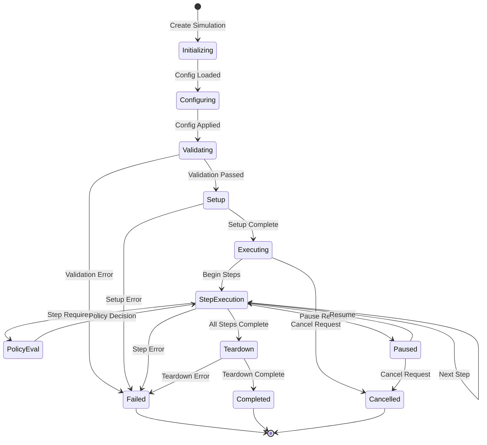

# ARCHITECTURE - Agentics Simulation Engine

> **SPARC Document Section 03**
> **Version:** 1.0.0
> **Status:** Draft
> **Last Updated:** 2026-01-04

---

## Executive Summary

The Agentics Simulation Engine is a hermetically isolated execution environment designed to evaluate agentic workflows, policy configurations, and deployment scenarios without affecting production systems. This document defines the internal component architecture, data contracts, event models, and integration boundaries that enable safe, deterministic simulation of complex agentic operations.

---

## 1. INTERNAL COMPONENTS

### 1.1 Component Overview

```
+------------------------------------------------------------------+
|                    AGENTICS SIMULATION ENGINE                     |
+------------------------------------------------------------------+
|                                                                   |
|  +------------------+    +-------------------+    +--------------+|
|  | SimulationEngine |<-->| ScenarioManager   |<-->| PolicyEngine ||
|  | (Core Orchestr.) |    | (Lifecycle Mgmt)  |    | (Evaluation) ||
|  +--------+---------+    +--------+----------+    +------+-------+|
|           |                       |                      |        |
|           v                       v                      v        |
|  +------------------+    +-------------------+    +--------------+|
|  | StateManager     |<-->| ArtifactGenerator |<-->| TraceCollect.||
|  | (State Tracking) |    | (Output Gen)      |    | (Audit/Log)  ||
|  +------------------+    +-------------------+    +--------------+|
|                                                                   |
+------------------------------------------------------------------+
```

### 1.2 SimulationEngine (Core Orchestrator)

The `SimulationEngine` is the central coordination component responsible for managing the complete simulation lifecycle.

**Responsibilities:**
- Initialize and bootstrap simulation environments
- Coordinate component interactions during execution
- Manage simulation execution phases (setup, run, teardown)
- Handle error recovery and graceful degradation
- Enforce resource limits and timeout constraints
- Provide execution context to child components

**Internal Architecture:**
```
SimulationEngine
├── ExecutionController
│   ├── PhaseManager (setup/run/teardown)
│   ├── TimeoutController
│   └── ResourceLimiter
├── ComponentRegistry
│   ├── ComponentLifecycle
│   └── DependencyResolver
├── ContextProvider
│   ├── SimulationContext
│   └── IsolationBoundary
└── ErrorHandler
    ├── RecoveryStrategy
    └── FailureClassifier
```

**Key Operations:**
| Operation | Description | Idempotent |
|-----------|-------------|------------|
| `initialize(config)` | Bootstrap simulation with configuration | Yes |
| `execute(scenario)` | Run scenario through simulation | No |
| `pause()` | Suspend active simulation | Yes |
| `resume()` | Continue paused simulation | Yes |
| `terminate()` | Gracefully stop and cleanup | Yes |
| `getStatus()` | Return current execution state | Yes |

---

### 1.3 ScenarioManager (Scenario Lifecycle)

The `ScenarioManager` handles the complete lifecycle of simulation scenarios from loading through completion.

**Responsibilities:**
- Load and validate scenario definitions
- Manage scenario versioning and variants
- Coordinate scenario step execution
- Handle scenario branching and parallel paths
- Maintain scenario execution history
- Support scenario composition (nested/chained scenarios)

**Lifecycle States:**
```
                    +----------+
                    |  DRAFT   |
                    +----+-----+
                         |
                         v
+----------+       +-----------+       +------------+
| ARCHIVED |<------| VALIDATED |------>| SCHEDULED  |
+----------+       +-----------+       +-----+------+
     ^                   ^                   |
     |                   |                   v
     |             +-----+-----+       +-----------+
     +-------------| COMPLETED |<------| EXECUTING |
                   +-----------+       +-----+-----+
                         ^                   |
                         |                   v
                   +-----+-----+       +-----------+
                   | CANCELLED |<------| PAUSED    |
                   +-----------+       +-----------+
```

**Scenario Composition Model:**
```typescript
// Scenarios can be composed hierarchically
RootScenario
├── PreConditionScenario[]
├── MainExecutionScenario
│   ├── ParallelBranch[]
│   └── SequentialStep[]
├── PostConditionScenario[]
└── CleanupScenario
```

---

### 1.4 PolicyEngine (Policy Evaluation)

The `PolicyEngine` evaluates governance policies against simulation state and actions.

**Responsibilities:**
- Load and parse policy definitions
- Evaluate policies at defined decision points
- Support multiple policy languages (OPA/Rego, CEL, custom DSL)
- Cache policy evaluation results
- Track policy violations and warnings
- Generate policy compliance reports

**Policy Evaluation Pipeline:**
```
Input Context
     │
     v
+--------------------+
| Policy Selection   |  ← Match policies to context
+--------------------+
     │
     v
+--------------------+
| Priority Ordering  |  ← Sort by precedence/specificity
+--------------------+
     │
     v
+--------------------+
| Sequential Eval    |  ← Evaluate in order, short-circuit on deny
+--------------------+
     │
     v
+--------------------+
| Result Aggregation |  ← Combine decisions, collect violations
+--------------------+
     │
     v
+--------------------+
| Audit Recording    |  ← Log decision with rationale
+--------------------+
     │
     v
Policy Decision (ALLOW | DENY | WARN)
```

**Policy Decision Types:**
| Decision | Effect | Continue Execution |
|----------|--------|-------------------|
| `ALLOW` | Action permitted | Yes |
| `DENY` | Action blocked | No (exception path) |
| `WARN` | Action permitted with advisory | Yes |
| `REQUIRE_APPROVAL` | Action queued for review | Conditional |
| `AUDIT_ONLY` | Action logged, no enforcement | Yes |

---

### 1.5 StateManager (Simulation State)

The `StateManager` maintains the complete state of the simulation, including snapshots for rollback and replay.

**Responsibilities:**
- Maintain current simulation state
- Create and manage state snapshots
- Support state rollback and replay
- Provide state diffing capabilities
- Enforce state immutability during reads
- Manage state persistence and recovery

**State Hierarchy:**
```
SimulationState
├── EngineState
│   ├── ExecutionPhase
│   ├── ResourceUtilization
│   └── ComponentHealth
├── ScenarioState
│   ├── CurrentStep
│   ├── StepHistory
│   └── BranchState
├── PolicyState
│   ├── AppliedPolicies
│   ├── Violations
│   └── Overrides
├── EntityState
│   ├── Agents
│   ├── Resources
│   └── Artifacts
└── EnvironmentState
    ├── MockedServices
    ├── InjectedData
    └── TimeState (simulated clock)
```

**State Operations:**
```typescript
// State access patterns
interface StateAccessor<T> {
  // Read current state (immutable view)
  get(): Readonly<T>;

  // Get state at specific point
  getAt(snapshotId: SnapshotId): Readonly<T>;

  // Compare states
  diff(from: SnapshotId, to: SnapshotId): StateDiff<T>;

  // Subscribe to state changes
  subscribe(handler: StateChangeHandler<T>): Unsubscribe;
}

// State mutation patterns
interface StateMutator<T> {
  // Apply atomic update
  update(mutation: StateMutation<T>): StateUpdateResult;

  // Create checkpoint
  snapshot(): SnapshotId;

  // Restore to checkpoint
  rollback(snapshotId: SnapshotId): void;
}
```

---

### 1.6 ArtifactGenerator (Output Generation)

The `ArtifactGenerator` produces all outputs from simulation execution including reports, exported configurations, and deployment manifests.

**Responsibilities:**
- Generate simulation reports and summaries
- Export deployment-ready configurations
- Create audit trails and compliance documents
- Produce visualization data
- Package artifacts for downstream consumption
- Manage artifact versioning and signatures

**Artifact Types:**
| Category | Artifact Type | Format | Consumer |
|----------|---------------|--------|----------|
| Reports | ExecutionReport | JSON/HTML/PDF | Platform Users |
| Reports | ComplianceReport | JSON/PDF | Governance |
| Export | DeploymentManifest | YAML/JSON | Deployment Pipeline |
| Export | ConfigurationBundle | ZIP | Config Management |
| Audit | ExecutionTrace | JSON | Audit Systems |
| Audit | PolicyDecisionLog | JSON | Compliance |
| Visualization | TimelineData | JSON | UI Dashboard |
| Visualization | DependencyGraph | DOT/SVG | Analysis Tools |

**Artifact Generation Pipeline:**
```
Simulation Completion
        │
        v
+-------------------+
| Data Collection   |  ← Gather state, traces, metrics
+-------------------+
        │
        v
+-------------------+
| Template Selection|  ← Choose artifact templates
+-------------------+
        │
        v
+-------------------+
| Rendering Engine  |  ← Generate artifact content
+-------------------+
        │
        v
+-------------------+
| Validation        |  ← Schema validation, integrity checks
+-------------------+
        │
        v
+-------------------+
| Signing/Packaging |  ← Add signatures, bundle files
+-------------------+
        │
        v
+-------------------+
| Storage/Delivery  |  ← Persist and notify consumers
+-------------------+
```

---

### 1.7 TraceCollector (Audit/Logging)

The `TraceCollector` captures comprehensive execution traces for debugging, compliance, and analysis.

**Responsibilities:**
- Capture all significant execution events
- Maintain causal ordering of events
- Support distributed trace correlation
- Enable trace sampling for high-volume scenarios
- Provide trace querying and filtering
- Export traces in standard formats (OpenTelemetry)

**Trace Structure:**
```
ExecutionTrace
├── TraceId (global identifier)
├── SpanTree
│   ├── RootSpan (simulation execution)
│   │   ├── ScenarioSpan
│   │   │   ├── StepSpan[]
│   │   │   └── PolicyEvalSpan[]
│   │   ├── StateChangeSpan[]
│   │   └── ArtifactGenSpan[]
│   └── Annotations[]
├── Events[]
│   ├── Timestamp
│   ├── EventType
│   ├── Payload
│   └── CausalLinks
└── Metrics
    ├── Counters
    ├── Gauges
    └── Histograms
```

---

## 2. DATA CONTRACTS

### 2.1 Core Interfaces

```typescript
/**
 * Root configuration for simulation execution
 * Immutable after simulation initialization
 */
interface SimulationConfig {
  /** Unique identifier for this simulation run */
  readonly simulationId: SimulationId;

  /** Human-readable name for the simulation */
  readonly name: string;

  /** Semantic version of the simulation engine */
  readonly engineVersion: SemanticVersion;

  /** Scenario to execute */
  readonly scenario: ScenarioReference;

  /** Policies to apply during execution */
  readonly policies: PolicyReference[];

  /** Resource constraints for execution */
  readonly resourceLimits: ResourceLimits;

  /** Execution timing configuration */
  readonly timing: TimingConfig;

  /** Data sources and mock configurations */
  readonly dataSources: DataSourceConfig[];

  /** Artifact generation settings */
  readonly artifactConfig: ArtifactConfig;

  /** Tracing and observability settings */
  readonly observability: ObservabilityConfig;

  /** Metadata and labels */
  readonly metadata: SimulationMetadata;
}

interface SimulationId extends Tagged<string, 'SimulationId'> {}

interface SemanticVersion {
  readonly major: number;
  readonly minor: number;
  readonly patch: number;
  readonly prerelease?: string;
}

interface ResourceLimits {
  /** Maximum execution wall-clock time (milliseconds) */
  readonly maxExecutionTimeMs: number;

  /** Maximum memory allocation (bytes) */
  readonly maxMemoryBytes: number;

  /** Maximum concurrent operations */
  readonly maxConcurrency: number;

  /** Maximum state snapshots to retain */
  readonly maxSnapshots: number;

  /** Maximum trace events to collect */
  readonly maxTraceEvents: number;
}

interface TimingConfig {
  /** Simulated time mode: 'real' | 'accelerated' | 'controlled' */
  readonly mode: TimeMode;

  /** Acceleration factor for 'accelerated' mode */
  readonly accelerationFactor?: number;

  /** Step duration for 'controlled' mode */
  readonly stepDurationMs?: number;

  /** Simulation start time (ISO 8601) */
  readonly simulatedStartTime: ISOTimestamp;
}

type TimeMode = 'real' | 'accelerated' | 'controlled';
```

### 2.2 Scenario Contract

```typescript
/**
 * Complete scenario definition for simulation
 * Describes what to simulate and expected outcomes
 */
interface Scenario {
  /** Unique scenario identifier */
  readonly scenarioId: ScenarioId;

  /** Scenario version for tracking changes */
  readonly version: SemanticVersion;

  /** Human-readable scenario name */
  readonly name: string;

  /** Detailed description of scenario purpose */
  readonly description: string;

  /** Scenario classification */
  readonly category: ScenarioCategory;

  /** Tags for filtering and organization */
  readonly tags: readonly string[];

  /** Prerequisites that must be satisfied */
  readonly preconditions: Precondition[];

  /** Initial state setup */
  readonly setup: SetupStep[];

  /** Main execution steps */
  readonly steps: ScenarioStep[];

  /** Cleanup operations (always executed) */
  readonly teardown: TeardownStep[];

  /** Expected outcomes and assertions */
  readonly expectations: Expectation[];

  /** Scenario-specific parameter values */
  readonly parameters: ScenarioParameters;

  /** Timeout override for this scenario */
  readonly timeoutMs?: number;
}

interface ScenarioId extends Tagged<string, 'ScenarioId'> {}

type ScenarioCategory =
  | 'deployment'      // Deployment simulation
  | 'policy'          // Policy evaluation
  | 'integration'     // Integration testing
  | 'failure'         // Failure/recovery scenarios
  | 'performance'     // Performance analysis
  | 'compliance'      // Compliance verification
  | 'migration';      // Migration dry-run

interface ScenarioStep {
  /** Unique step identifier within scenario */
  readonly stepId: StepId;

  /** Step ordering (supports parallel execution) */
  readonly order: StepOrder;

  /** Step type discriminator */
  readonly type: StepType;

  /** Step-specific configuration */
  readonly config: StepConfig;

  /** Conditions for step execution */
  readonly when?: StepCondition;

  /** Retry configuration */
  readonly retry?: RetryConfig;

  /** Step-level timeout */
  readonly timeoutMs?: number;

  /** Step-specific assertions */
  readonly assertions?: Assertion[];
}

interface StepOrder {
  /** Primary ordering index */
  readonly index: number;

  /** Parallel group (steps in same group run concurrently) */
  readonly parallelGroup?: string;

  /** Dependencies (step IDs that must complete first) */
  readonly dependsOn?: StepId[];
}

type StepType =
  | 'agent_action'      // Simulate agent performing action
  | 'data_injection'    // Inject test data
  | 'state_mutation'    // Modify simulation state
  | 'policy_evaluation' // Evaluate policy decision
  | 'assertion'         // Verify conditions
  | 'delay'             // Simulated time passage
  | 'branch'            // Conditional branching
  | 'loop'              // Repeated execution
  | 'subprocess';       // Nested scenario

interface Expectation {
  /** Expectation identifier */
  readonly expectationId: string;

  /** What is being verified */
  readonly description: string;

  /** Assertion to evaluate */
  readonly assertion: Assertion;

  /** Severity if expectation fails */
  readonly severity: 'error' | 'warning' | 'info';

  /** When to evaluate */
  readonly evaluateAt: 'step' | 'end' | 'continuous';
}
```

### 2.3 Policy Contract

```typescript
/**
 * Policy definition for governance evaluation
 * Policies are evaluated at decision points during simulation
 */
interface Policy {
  /** Unique policy identifier */
  readonly policyId: PolicyId;

  /** Policy version */
  readonly version: SemanticVersion;

  /** Human-readable policy name */
  readonly name: string;

  /** Policy description and rationale */
  readonly description: string;

  /** Policy enforcement level */
  readonly enforcement: EnforcementLevel;

  /** When this policy applies */
  readonly applicability: PolicyApplicability;

  /** Policy rules (evaluated in order) */
  readonly rules: PolicyRule[];

  /** Default decision if no rules match */
  readonly defaultDecision: PolicyDecision;

  /** Policy metadata */
  readonly metadata: PolicyMetadata;
}

interface PolicyId extends Tagged<string, 'PolicyId'> {}

type EnforcementLevel =
  | 'strict'      // Violations block execution
  | 'advisory'    // Violations logged but not blocking
  | 'audit';      // Violations only recorded in trace

interface PolicyApplicability {
  /** Resource types this policy applies to */
  readonly resourceTypes?: string[];

  /** Action types this policy applies to */
  readonly actionTypes?: string[];

  /** Environments where policy is active */
  readonly environments?: string[];

  /** Custom applicability expression */
  readonly expression?: PolicyExpression;
}

interface PolicyRule {
  /** Rule identifier */
  readonly ruleId: string;

  /** Rule description */
  readonly description: string;

  /** Condition expression */
  readonly condition: PolicyExpression;

  /** Decision if condition matches */
  readonly decision: PolicyDecision;

  /** Priority (higher = evaluated first) */
  readonly priority: number;
}

interface PolicyDecision {
  /** Decision outcome */
  readonly outcome: 'allow' | 'deny' | 'warn' | 'require_approval';

  /** Reason for decision */
  readonly reason: string;

  /** Remediation guidance if denied */
  readonly remediation?: string;

  /** Additional context data */
  readonly context?: Record<string, unknown>;
}

/**
 * Policy expression supporting multiple languages
 */
type PolicyExpression =
  | { readonly lang: 'rego'; readonly code: string }
  | { readonly lang: 'cel'; readonly code: string }
  | { readonly lang: 'jsonpath'; readonly expression: string }
  | { readonly lang: 'custom'; readonly evaluator: string; readonly config: unknown };
```

### 2.4 State Contract

```typescript
/**
 * Complete simulation state at a point in time
 * Supports snapshotting, diffing, and time-travel
 */
interface SimulationState {
  /** State version (incremented on each mutation) */
  readonly version: StateVersion;

  /** Timestamp of this state */
  readonly timestamp: ISOTimestamp;

  /** Simulated time (may differ from wall clock) */
  readonly simulatedTime: ISOTimestamp;

  /** Current execution phase */
  readonly phase: ExecutionPhase;

  /** Scenario execution state */
  readonly scenarioState: ScenarioState;

  /** Entity registry (agents, resources, etc.) */
  readonly entities: EntityRegistry;

  /** Applied policy state */
  readonly policyState: PolicyState;

  /** Environment state (mocks, injections) */
  readonly environment: EnvironmentState;

  /** Accumulated metrics */
  readonly metrics: StateMetrics;

  /** Pending operations queue */
  readonly pendingOperations: PendingOperation[];
}

interface StateVersion extends Tagged<number, 'StateVersion'> {}

type ExecutionPhase =
  | 'initializing'
  | 'setup'
  | 'executing'
  | 'paused'
  | 'teardown'
  | 'completed'
  | 'failed'
  | 'cancelled';

interface ScenarioState {
  /** Current scenario reference */
  readonly scenario: ScenarioReference;

  /** Completed steps */
  readonly completedSteps: CompletedStep[];

  /** Currently executing step(s) */
  readonly activeSteps: ActiveStep[];

  /** Pending steps */
  readonly pendingSteps: StepId[];

  /** Step execution results */
  readonly stepResults: Map<StepId, StepResult>;

  /** Branch state for conditional paths */
  readonly branchState: BranchState;
}

interface EntityRegistry {
  /** Simulated agents */
  readonly agents: Map<AgentId, SimulatedAgent>;

  /** Simulated resources */
  readonly resources: Map<ResourceId, SimulatedResource>;

  /** Generated artifacts */
  readonly artifacts: Map<ArtifactId, ArtifactReference>;

  /** Entity relationships */
  readonly relationships: EntityRelationship[];
}

interface SimulatedAgent {
  readonly agentId: AgentId;
  readonly type: string;
  readonly state: AgentState;
  readonly capabilities: string[];
  readonly lastAction: ISOTimestamp;
  readonly actionHistory: AgentAction[];
}

interface EnvironmentState {
  /** Mocked external services */
  readonly mocks: MockConfiguration[];

  /** Injected test data */
  readonly injections: DataInjection[];

  /** Simulated clock state */
  readonly clock: SimulatedClock;

  /** Feature flags */
  readonly featureFlags: Map<string, boolean>;
}
```

### 2.5 Trace Contract

```typescript
/**
 * Execution trace for audit and debugging
 * Follows OpenTelemetry conventions
 */
interface ExecutionTrace {
  /** Globally unique trace identifier */
  readonly traceId: TraceId;

  /** Simulation this trace belongs to */
  readonly simulationId: SimulationId;

  /** Trace start timestamp */
  readonly startTime: ISOTimestamp;

  /** Trace end timestamp (if completed) */
  readonly endTime?: ISOTimestamp;

  /** Root span of the trace */
  readonly rootSpan: TraceSpan;

  /** Flat list of all events */
  readonly events: TraceEvent[];

  /** Trace-level attributes */
  readonly attributes: TraceAttributes;

  /** Sampling decision */
  readonly sampling: SamplingDecision;
}

interface TraceId extends Tagged<string, 'TraceId'> {}

interface TraceSpan {
  /** Unique span identifier */
  readonly spanId: SpanId;

  /** Parent span (null for root) */
  readonly parentSpanId: SpanId | null;

  /** Span operation name */
  readonly operationName: string;

  /** Span timing */
  readonly startTime: ISOTimestamp;
  readonly endTime?: ISOTimestamp;

  /** Span status */
  readonly status: SpanStatus;

  /** Span attributes */
  readonly attributes: SpanAttributes;

  /** Child spans */
  readonly children: TraceSpan[];

  /** Events within this span */
  readonly events: SpanEvent[];
}

interface TraceEvent {
  /** Event identifier */
  readonly eventId: EventId;

  /** Event type discriminator */
  readonly type: TraceEventType;

  /** Precise timestamp */
  readonly timestamp: ISOTimestamp;

  /** Associated span */
  readonly spanId: SpanId;

  /** Event payload */
  readonly payload: TraceEventPayload;

  /** Causal predecessor events */
  readonly causedBy?: EventId[];

  /** Severity level */
  readonly level: 'trace' | 'debug' | 'info' | 'warn' | 'error';
}

type TraceEventType =
  | 'simulation_started'
  | 'simulation_completed'
  | 'simulation_failed'
  | 'scenario_started'
  | 'scenario_completed'
  | 'step_started'
  | 'step_completed'
  | 'step_failed'
  | 'policy_evaluated'
  | 'policy_decision'
  | 'state_snapshot'
  | 'state_rollback'
  | 'artifact_generated'
  | 'mock_invoked'
  | 'data_injected'
  | 'assertion_evaluated'
  | 'custom';

interface TraceEventPayload {
  /** Event-specific data */
  readonly data: unknown;

  /** State reference at event time */
  readonly stateVersion?: StateVersion;

  /** Duration in milliseconds (for completed operations) */
  readonly durationMs?: number;

  /** Error information (for failure events) */
  readonly error?: ErrorInfo;
}
```

### 2.6 Result Contract

```typescript
/**
 * Complete simulation result
 * Produced after simulation completion or termination
 */
interface SimulationResult {
  /** Reference to simulation */
  readonly simulationId: SimulationId;

  /** Result status */
  readonly status: SimulationStatus;

  /** Execution timing */
  readonly timing: ExecutionTiming;

  /** Scenario results */
  readonly scenarioResult: ScenarioResult;

  /** Policy evaluation summary */
  readonly policyResult: PolicyResult;

  /** Generated artifacts */
  readonly artifacts: ArtifactManifest;

  /** Execution metrics */
  readonly metrics: ExecutionMetrics;

  /** Final state snapshot */
  readonly finalState: SimulationState;

  /** Trace reference */
  readonly traceRef: TraceReference;

  /** Result metadata */
  readonly metadata: ResultMetadata;
}

type SimulationStatus =
  | 'success'           // All expectations met
  | 'partial_success'   // Some expectations met
  | 'failure'           // Critical expectations failed
  | 'error'             // Execution error occurred
  | 'timeout'           // Execution timed out
  | 'cancelled';        // User/system cancelled

interface ExecutionTiming {
  /** Wall-clock start time */
  readonly startTime: ISOTimestamp;

  /** Wall-clock end time */
  readonly endTime: ISOTimestamp;

  /** Total wall-clock duration (ms) */
  readonly durationMs: number;

  /** Simulated time elapsed */
  readonly simulatedDuration: Duration;

  /** Time spent in each phase */
  readonly phaseTiming: Map<ExecutionPhase, number>;
}

interface ScenarioResult {
  /** Scenario reference */
  readonly scenario: ScenarioReference;

  /** Overall scenario status */
  readonly status: 'passed' | 'failed' | 'skipped';

  /** Individual step results */
  readonly stepResults: StepResult[];

  /** Expectation results */
  readonly expectationResults: ExpectationResult[];

  /** Coverage metrics */
  readonly coverage: CoverageMetrics;
}

interface PolicyResult {
  /** Total policies evaluated */
  readonly policiesEvaluated: number;

  /** Policy decisions by outcome */
  readonly decisionCounts: Map<string, number>;

  /** Policy violations */
  readonly violations: PolicyViolation[];

  /** Compliance score (0-100) */
  readonly complianceScore: number;

  /** Individual policy results */
  readonly policyResults: IndividualPolicyResult[];
}
```

### 2.7 Artifact Contract

```typescript
/**
 * Generated artifact from simulation
 * Immutable after creation
 */
interface Artifact {
  /** Unique artifact identifier */
  readonly artifactId: ArtifactId;

  /** Simulation that produced this artifact */
  readonly simulationId: SimulationId;

  /** Artifact type */
  readonly type: ArtifactType;

  /** Artifact format */
  readonly format: ArtifactFormat;

  /** Creation timestamp */
  readonly createdAt: ISOTimestamp;

  /** Content hash for integrity */
  readonly contentHash: ContentHash;

  /** Artifact size in bytes */
  readonly sizeBytes: number;

  /** Storage location */
  readonly location: ArtifactLocation;

  /** Artifact metadata */
  readonly metadata: ArtifactMetadata;

  /** Digital signature (if signed) */
  readonly signature?: ArtifactSignature;

  /** Expiration (if applicable) */
  readonly expiresAt?: ISOTimestamp;
}

interface ArtifactId extends Tagged<string, 'ArtifactId'> {}

type ArtifactType =
  | 'execution_report'
  | 'compliance_report'
  | 'deployment_manifest'
  | 'configuration_bundle'
  | 'execution_trace'
  | 'policy_decision_log'
  | 'timeline_visualization'
  | 'dependency_graph'
  | 'state_snapshot'
  | 'custom';

type ArtifactFormat =
  | 'json'
  | 'yaml'
  | 'html'
  | 'pdf'
  | 'csv'
  | 'parquet'
  | 'zip'
  | 'tar.gz'
  | 'svg'
  | 'dot';

interface ArtifactLocation {
  /** Storage type */
  readonly storageType: 'local' | 's3' | 'gcs' | 'azure_blob' | 'inline';

  /** Storage URI */
  readonly uri: string;

  /** Access credentials reference (not the credentials themselves) */
  readonly credentialsRef?: string;
}

interface ArtifactSignature {
  /** Signature algorithm */
  readonly algorithm: 'ed25519' | 'rsa-sha256' | 'ecdsa-p256';

  /** Signature value (base64) */
  readonly value: string;

  /** Signing key identifier */
  readonly keyId: string;

  /** Signature timestamp */
  readonly signedAt: ISOTimestamp;
}
```

### 2.8 Common Types

```typescript
/**
 * Tagged type helper for nominal typing
 */
interface Tagged<T, Tag extends string> {
  readonly __tag: Tag;
  readonly value: T;
}

/** ISO 8601 timestamp string */
type ISOTimestamp = string & { readonly __brand: 'ISOTimestamp' };

/** Duration in ISO 8601 format */
type Duration = string & { readonly __brand: 'Duration' };

/** SHA-256 content hash */
interface ContentHash {
  readonly algorithm: 'sha256';
  readonly value: string;
}

/** Reference to external entity */
interface ExternalReference {
  readonly type: string;
  readonly id: string;
  readonly version?: string;
  readonly uri?: string;
}

/** Error information */
interface ErrorInfo {
  readonly code: string;
  readonly message: string;
  readonly details?: unknown;
  readonly stack?: string;
  readonly retryable: boolean;
}

/** Assertion definition */
interface Assertion {
  readonly type: AssertionType;
  readonly expression: string;
  readonly message: string;
  readonly context?: Record<string, unknown>;
}

type AssertionType =
  | 'equals'
  | 'not_equals'
  | 'contains'
  | 'matches'
  | 'greater_than'
  | 'less_than'
  | 'exists'
  | 'not_exists'
  | 'custom';
```

---

## 3. EVENT AND STATE MODELS

### 3.1 Event Sourcing Architecture

The simulation engine employs event sourcing to maintain a complete, auditable history of all state changes.

```
+------------------+     +------------------+     +------------------+
|   Command/       |     |   Event          |     |   State          |
|   Action         |---->|   Store          |---->|   Projection     |
+------------------+     +------------------+     +------------------+
         |                        |                        |
         v                        v                        v
+------------------+     +------------------+     +------------------+
|   Validation     |     |   Event Bus      |     |   Read Models    |
|   & Policy Eval  |     |   (Subscribers)  |     |   (Queries)      |
+------------------+     +------------------+     +------------------+
```

**Event Store Properties:**
- Append-only log of all events
- Events are immutable once written
- Supports event replay for state reconstruction
- Provides causal ordering guarantees
- Enables point-in-time state queries

### 3.2 Core Event Types

```typescript
/**
 * Base event interface
 */
interface SimulationEvent {
  readonly eventId: EventId;
  readonly eventType: SimulationEventType;
  readonly timestamp: ISOTimestamp;
  readonly simulationId: SimulationId;
  readonly version: number;
  readonly correlationId: CorrelationId;
  readonly causationId?: EventId;
  readonly metadata: EventMetadata;
}

/**
 * Simulation lifecycle events
 */
interface SimulationStarted extends SimulationEvent {
  readonly eventType: 'SimulationStarted';
  readonly payload: {
    readonly config: SimulationConfig;
    readonly initiator: InitiatorInfo;
  };
}

interface SimulationCompleted extends SimulationEvent {
  readonly eventType: 'SimulationCompleted';
  readonly payload: {
    readonly status: SimulationStatus;
    readonly summary: ExecutionSummary;
  };
}

interface SimulationFailed extends SimulationEvent {
  readonly eventType: 'SimulationFailed';
  readonly payload: {
    readonly error: ErrorInfo;
    readonly lastGoodState: StateVersion;
  };
}

interface SimulationPaused extends SimulationEvent {
  readonly eventType: 'SimulationPaused';
  readonly payload: {
    readonly reason: string;
    readonly resumable: boolean;
  };
}

interface SimulationResumed extends SimulationEvent {
  readonly eventType: 'SimulationResumed';
  readonly payload: {
    readonly pausedDuration: number;
  };
}

/**
 * Scenario execution events
 */
interface ScenarioLoaded extends SimulationEvent {
  readonly eventType: 'ScenarioLoaded';
  readonly payload: {
    readonly scenario: Scenario;
    readonly resolvedParameters: ScenarioParameters;
  };
}

interface StepExecuted extends SimulationEvent {
  readonly eventType: 'StepExecuted';
  readonly payload: {
    readonly stepId: StepId;
    readonly stepType: StepType;
    readonly input: unknown;
    readonly output: unknown;
    readonly duration: number;
    readonly status: 'success' | 'failure' | 'skipped';
  };
}

interface StepSkipped extends SimulationEvent {
  readonly eventType: 'StepSkipped';
  readonly payload: {
    readonly stepId: StepId;
    readonly reason: string;
    readonly condition: StepCondition;
  };
}

/**
 * Policy evaluation events
 */
interface PolicyApplied extends SimulationEvent {
  readonly eventType: 'PolicyApplied';
  readonly payload: {
    readonly policyId: PolicyId;
    readonly context: PolicyEvaluationContext;
    readonly decision: PolicyDecision;
    readonly evaluationTime: number;
  };
}

interface PolicyViolationDetected extends SimulationEvent {
  readonly eventType: 'PolicyViolationDetected';
  readonly payload: {
    readonly policyId: PolicyId;
    readonly ruleId: string;
    readonly violation: PolicyViolation;
    readonly remediation?: string;
  };
}

/**
 * State management events
 */
interface StateSnapshotCreated extends SimulationEvent {
  readonly eventType: 'StateSnapshotCreated';
  readonly payload: {
    readonly snapshotId: SnapshotId;
    readonly stateVersion: StateVersion;
    readonly trigger: 'automatic' | 'manual' | 'checkpoint';
  };
}

interface StateRolledBack extends SimulationEvent {
  readonly eventType: 'StateRolledBack';
  readonly payload: {
    readonly fromVersion: StateVersion;
    readonly toVersion: StateVersion;
    readonly snapshotId: SnapshotId;
    readonly reason: string;
  };
}

interface EntityStateChanged extends SimulationEvent {
  readonly eventType: 'EntityStateChanged';
  readonly payload: {
    readonly entityType: string;
    readonly entityId: string;
    readonly previousState: unknown;
    readonly newState: unknown;
    readonly changeTrigger: string;
  };
}

/**
 * Artifact events
 */
interface ArtifactGenerated extends SimulationEvent {
  readonly eventType: 'ArtifactGenerated';
  readonly payload: {
    readonly artifact: Artifact;
    readonly generationTime: number;
  };
}

/**
 * Mock and injection events
 */
interface MockInvoked extends SimulationEvent {
  readonly eventType: 'MockInvoked';
  readonly payload: {
    readonly mockId: string;
    readonly service: string;
    readonly operation: string;
    readonly request: unknown;
    readonly response: unknown;
    readonly latency: number;
  };
}

interface DataInjected extends SimulationEvent {
  readonly eventType: 'DataInjected';
  readonly payload: {
    readonly injectionId: string;
    readonly dataSource: string;
    readonly recordCount: number;
    readonly schema: string;
  };
}

/**
 * Complete event type union
 */
type SimulationEventType =
  | 'SimulationStarted'
  | 'SimulationCompleted'
  | 'SimulationFailed'
  | 'SimulationPaused'
  | 'SimulationResumed'
  | 'SimulationCancelled'
  | 'ScenarioLoaded'
  | 'ScenarioStarted'
  | 'ScenarioCompleted'
  | 'StepExecuted'
  | 'StepSkipped'
  | 'StepRetried'
  | 'PolicyApplied'
  | 'PolicyViolationDetected'
  | 'PolicyOverridden'
  | 'StateSnapshotCreated'
  | 'StateRolledBack'
  | 'EntityStateChanged'
  | 'ArtifactGenerated'
  | 'MockInvoked'
  | 'DataInjected'
  | 'AssertionEvaluated'
  | 'CustomEvent';
```

### 3.3 State Transition Model

```
                              SIMULATION STATE MACHINE
+-----------------------------------------------------------------------------+
|                                                                             |
|     +--------+         +--------------+         +-----------+               |
|     | INIT   |-------->| CONFIGURING  |-------->| VALIDATING|               |
|     +--------+         +--------------+         +-----+-----+               |
|         |                    |                        |                     |
|         | error              | error                  | valid               |
|         v                    v                        v                     |
|     +--------+         +--------------+         +-----------+               |
|     | FAILED |<--------| FAILED       |<--------| SETUP     |               |
|     +--------+         +--------------+         +-----+-----+               |
|         ^                                             |                     |
|         |                                             | setup complete      |
|         |                                             v                     |
|         |    pause     +--------------+  resume  +-----------+              |
|         |  +---------->| PAUSED       |--------->| EXECUTING |<--+          |
|         |  |           +--------------+          +-----+-----+   |          |
|         |  |                                           |         | retry    |
|         |  |           error                           |         |          |
|         +--+------+------------------------------------+         |          |
|            |      |    |                               |         |          |
|            |      |    v                               v         |          |
|            |      |  +--------+                  +-----------+   |          |
|            |      |  | FAILED |                  | STEP_EXEC |---+          |
|            |      |  +--------+                  +-----+-----+              |
|            |      |                                    |                    |
|         cancel    |                                    | all steps done     |
|            |      |                                    v                    |
|            v      |                              +-----------+              |
|     +-----------+ |                              | TEARDOWN  |              |
|     | CANCELLED | |                              +-----+-----+              |
|     +-----------+ |                                    |                    |
|                   |                                    | teardown complete  |
|                   |                                    v                    |
|                   |                              +-----------+              |
|                   +----------------------------->| COMPLETED |              |
|                                                  +-----------+              |
|                                                                             |
+-----------------------------------------------------------------------------+
```

### 3.4 Event Processing Pipeline

```typescript
/**
 * Event processing stages
 */
interface EventPipeline {
  /** Validate event structure and data */
  validate(event: SimulationEvent): ValidationResult;

  /** Enrich event with derived data */
  enrich(event: SimulationEvent): EnrichedEvent;

  /** Persist to event store */
  persist(event: EnrichedEvent): Promise<PersistedEvent>;

  /** Update projections */
  project(event: PersistedEvent): Promise<void>;

  /** Notify subscribers */
  publish(event: PersistedEvent): Promise<void>;
}

/**
 * Event subscription model
 */
interface EventSubscription {
  readonly subscriptionId: string;
  readonly eventTypes: SimulationEventType[];
  readonly filter?: EventFilter;
  readonly handler: EventHandler;
  readonly options: SubscriptionOptions;
}

interface SubscriptionOptions {
  /** Receive events from beginning or current position */
  readonly startFrom: 'beginning' | 'current' | EventId;

  /** Batch events for efficiency */
  readonly batchSize?: number;

  /** Max time to wait before delivering partial batch */
  readonly batchTimeoutMs?: number;

  /** Enable exactly-once processing */
  readonly exactlyOnce: boolean;
}
```

---

## 4. INTEGRATION BOUNDARIES

### 4.1 Integration Architecture Overview

```
+------------------------------------------------------------------+
|                     EXTERNAL SYSTEMS                              |
+------------------------------------------------------------------+
|                                                                   |
|  +----------------+  +----------------+  +--------------------+   |
|  | ERP Surface    |  | Policy/Gov     |  | CostOps            |   |
|  | (Data Source)  |  | (Policy Input) |  | (Baseline Data)    |   |
|  +-------+--------+  +-------+--------+  +---------+----------+   |
|          |                   |                     |              |
|          v                   v                     v              |
|  +-------+-------------------+---------------------+-----------+  |
|  |              INTEGRATION GATEWAY                            |  |
|  |  +------------+ +------------+ +------------+ +----------+  |  |
|  |  | Adapters   | | Validators | | Transformr | | Monitors |  |  |
|  |  +------------+ +------------+ +------------+ +----------+  |  |
|  +-----------------------------+-------------------------------+  |
|                                |                                  |
+--------------------------------|----------------------------------+
                                 |
                                 v
+--------------------------------|----------------------------------+
|                                |                                  |
|  +-----------------------------+-------------------------------+  |
|  |           SIMULATION ENGINE (ISOLATED)                      |  |
|  +-------------------------------------------------------------+  |
|                                |                                  |
+--------------------------------|----------------------------------+
                                 |
                                 v
+------------------------------------------------------------------+
|                     OUTPUT CONSUMERS                              |
+------------------------------------------------------------------+
|                                                                   |
|  +----------------+  +----------------+  +--------------------+   |
|  | Orchestrators  |  | Deployment     |  | Platform CLI/API   |   |
|  | (Triggers)     |  | Exporters      |  | (User Interface)   |   |
|  +----------------+  +----------------+  +--------------------+   |
|                                                                   |
+------------------------------------------------------------------+
```

### 4.2 erp-surface Integration

**Purpose:** Consume normalized ERP data for simulation scenarios.

**Integration Pattern:** Read-only data fetch via adapter

```typescript
interface ERPSurfaceAdapter {
  /**
   * Fetch normalized entity data
   * @param query Entity query specification
   * @returns Normalized entity data
   */
  fetchEntities(query: EntityQuery): Promise<NormalizedEntitySet>;

  /**
   * Get data schema for validation
   * @param entityType Type of entity
   * @returns JSON Schema for entity
   */
  getSchema(entityType: string): Promise<JSONSchema>;

  /**
   * Subscribe to data changes (for long-running simulations)
   * @param subscription Change subscription
   * @returns Subscription handle
   */
  subscribeToChanges(subscription: ChangeSubscription): SubscriptionHandle;
}

interface EntityQuery {
  readonly entityTypes: string[];
  readonly filters: QueryFilter[];
  readonly includeRelationships: boolean;
  readonly asOfTimestamp?: ISOTimestamp;
  readonly limit?: number;
}

interface NormalizedEntitySet {
  readonly entities: Map<string, NormalizedEntity[]>;
  readonly relationships: EntityRelationship[];
  readonly metadata: {
    readonly sourceSystem: string;
    readonly extractedAt: ISOTimestamp;
    readonly schemaVersion: string;
  };
}
```

**Data Flow:**
```
erp-surface                    Simulation Engine
    |                                  |
    |  1. Query (read-only)            |
    |<---------------------------------|
    |                                  |
    |  2. Normalized Data              |
    |--------------------------------->|
    |                                  |
    |  3. Schema (for validation)      |
    |<---------------------------------|
    |                                  |
    |  4. Schema Response              |
    |--------------------------------->|
    |                                  |
```

**Security Boundaries:**
- Read-only access enforced at adapter level
- Data is copied into simulation sandbox
- No write-back capability
- Credentials scoped to read operations only

---

### 4.3 Policy/Governance Systems Integration

**Purpose:** Receive policy definitions for simulation evaluation.

**Integration Pattern:** Policy import with version tracking

```typescript
interface PolicySystemAdapter {
  /**
   * Fetch policies applicable to simulation context
   * @param context Policy context (environment, resource types, etc.)
   * @returns Applicable policies
   */
  fetchPolicies(context: PolicyContext): Promise<PolicySet>;

  /**
   * Get specific policy version
   * @param policyId Policy identifier
   * @param version Specific version or 'latest'
   * @returns Policy definition
   */
  getPolicy(policyId: PolicyId, version?: string): Promise<Policy>;

  /**
   * Validate policy syntax
   * @param policy Policy to validate
   * @returns Validation result
   */
  validatePolicy(policy: Policy): Promise<PolicyValidationResult>;

  /**
   * Report policy decisions back (for governance auditing)
   * @param decisions Decisions made during simulation
   */
  reportDecisions(decisions: PolicyDecisionReport): Promise<void>;
}

interface PolicyContext {
  readonly environment: string;
  readonly resourceTypes: string[];
  readonly actionTypes: string[];
  readonly labels: Map<string, string>;
}

interface PolicySet {
  readonly policies: Policy[];
  readonly version: string;
  readonly effectiveDate: ISOTimestamp;
  readonly source: string;
}
```

**Policy Input Format:**
```yaml
# Standard policy document format
apiVersion: policy/v1
kind: SimulationPolicy
metadata:
  name: resource-limit-policy
  version: 1.2.0
  labels:
    environment: production
    category: resource-governance
spec:
  enforcement: strict
  applicability:
    resourceTypes:
      - compute-instance
      - storage-volume
    environments:
      - production
      - staging
  rules:
    - id: max-instance-size
      description: Limit instance size to approved list
      condition:
        lang: cel
        code: "resource.size in ['small', 'medium', 'large']"
      decision:
        outcome: deny
        reason: "Instance size not in approved list"
```

---

### 4.4 CostOps Integration

**Purpose:** Consume cost baseline data for simulation scenarios (no calculations performed by simulation engine).

**Integration Pattern:** Baseline data import only

```typescript
interface CostOpsAdapter {
  /**
   * Fetch cost baseline data for entities
   * IMPORTANT: Simulation engine does NOT perform cost calculations
   * This is baseline data only for scenario inputs
   *
   * @param entities Entities to get baselines for
   * @returns Cost baseline data
   */
  fetchBaselines(entities: EntityReference[]): Promise<CostBaselineSet>;

  /**
   * Get rate card for reference (read-only)
   * @param rateCardId Rate card identifier
   * @returns Rate card data
   */
  getRateCard(rateCardId: string): Promise<RateCard>;
}

interface CostBaselineSet {
  readonly baselines: CostBaseline[];
  readonly asOfDate: ISOTimestamp;
  readonly currency: CurrencyCode;
  readonly source: string;
}

interface CostBaseline {
  readonly entityId: string;
  readonly entityType: string;
  readonly baselinePeriod: DateRange;
  readonly metrics: {
    readonly dailyAverage: number;
    readonly monthlyTotal: number;
    readonly trend: 'increasing' | 'decreasing' | 'stable';
  };
  /** Baseline data only - no calculations performed */
  readonly rawData: unknown;
}
```

**Important Boundary:**
- Simulation engine receives pre-calculated baselines
- No cost calculation logic resides in simulation
- CostOps owns all cost computation
- Simulation uses baselines as input parameters only

---

### 4.5 Orchestrators Integration

**Purpose:** Enable orchestrators to trigger and monitor simulations.

**Integration Pattern:** Event-driven with command/query separation

```typescript
interface OrchestratorInterface {
  /**
   * Commands - Trigger simulation operations
   */
  commands: {
    /** Start a new simulation */
    startSimulation(request: SimulationRequest): Promise<SimulationHandle>;

    /** Pause running simulation */
    pauseSimulation(simulationId: SimulationId): Promise<void>;

    /** Resume paused simulation */
    resumeSimulation(simulationId: SimulationId): Promise<void>;

    /** Cancel simulation */
    cancelSimulation(simulationId: SimulationId, reason: string): Promise<void>;
  };

  /**
   * Queries - Get simulation status
   */
  queries: {
    /** Get simulation status */
    getStatus(simulationId: SimulationId): Promise<SimulationStatus>;

    /** List active simulations */
    listActive(filter?: SimulationFilter): Promise<SimulationSummary[]>;

    /** Get simulation result */
    getResult(simulationId: SimulationId): Promise<SimulationResult>;
  };

  /**
   * Events - Subscribe to simulation events
   */
  events: {
    /** Subscribe to simulation events */
    subscribe(
      simulationId: SimulationId,
      eventTypes: SimulationEventType[],
      handler: EventHandler
    ): SubscriptionHandle;

    /** Subscribe to all simulation events (for monitoring) */
    subscribeAll(
      filter: SimulationFilter,
      handler: EventHandler
    ): SubscriptionHandle;
  };
}

interface SimulationRequest {
  readonly scenarioId: ScenarioId;
  readonly parameters: ScenarioParameters;
  readonly policies: PolicyReference[];
  readonly priority: 'low' | 'normal' | 'high' | 'critical';
  readonly requestedBy: RequestorInfo;
  readonly metadata: Map<string, string>;
}

interface SimulationHandle {
  readonly simulationId: SimulationId;
  readonly status: SimulationStatus;
  readonly estimatedDuration?: Duration;
  readonly queuePosition?: number;
}
```

**Trigger Patterns:**
```
+-------------------+     +-----------------------+     +------------------+
| Orchestrator      |     | Simulation Engine     |     | Event Bus        |
+-------------------+     +-----------------------+     +------------------+
         |                          |                          |
         | 1. startSimulation()     |                          |
         |------------------------->|                          |
         |                          |                          |
         | 2. SimulationHandle      |                          |
         |<-------------------------|                          |
         |                          |                          |
         |                          | 3. SimulationStarted     |
         |                          |------------------------->|
         |                          |                          |
         | 4. Event subscription    |                          |
         |--------------------------------------------------->|
         |                          |                          |
         |                          | 5. Progress events       |
         |<---------------------------------------------------|
         |                          |                          |
         |                          | 6. SimulationCompleted   |
         |<---------------------------------------------------|
         |                          |                          |
         | 7. getResult()           |                          |
         |------------------------->|                          |
         |                          |                          |
         | 8. SimulationResult      |                          |
         |<-------------------------|                          |
```

---

### 4.6 Deployment Exporters Integration

**Purpose:** Hand off deployment-ready artifacts to export systems.

**Integration Pattern:** Artifact notification with pull-based retrieval

```typescript
interface DeploymentExporterInterface {
  /**
   * Notify exporter of available artifacts
   * Exporter will pull artifacts when ready
   */
  notifyArtifactsAvailable(notification: ArtifactNotification): Promise<void>;

  /**
   * Get artifact manifest for export
   * @param simulationId Simulation that produced artifacts
   * @returns Manifest of exportable artifacts
   */
  getExportManifest(simulationId: SimulationId): Promise<ExportManifest>;

  /**
   * Retrieve specific artifact
   * @param artifactId Artifact to retrieve
   * @returns Artifact content stream
   */
  getArtifact(artifactId: ArtifactId): Promise<ArtifactStream>;

  /**
   * Mark artifacts as exported (for tracking)
   * @param artifactIds Exported artifact IDs
   */
  markExported(artifactIds: ArtifactId[]): Promise<void>;
}

interface ArtifactNotification {
  readonly simulationId: SimulationId;
  readonly artifacts: ArtifactSummary[];
  readonly expiresAt: ISOTimestamp;
  readonly priority: 'normal' | 'urgent';
}

interface ExportManifest {
  readonly simulationId: SimulationId;
  readonly artifacts: ExportableArtifact[];
  readonly dependencies: ArtifactDependency[];
  readonly exportInstructions: ExportInstructions;
}

interface ExportableArtifact {
  readonly artifactId: ArtifactId;
  readonly type: ArtifactType;
  readonly format: ArtifactFormat;
  readonly sizeBytes: number;
  readonly checksums: Map<string, string>;
  readonly targetPath: string;
}
```

**Artifact Handoff Flow:**
```
Simulation Engine              Deployment Exporter           Artifact Store
       |                              |                            |
       | 1. Generate artifacts        |                            |
       |----------------------------------------------------->|
       |                              |                            |
       | 2. notifyArtifactsAvailable  |                            |
       |----------------------------->|                            |
       |                              |                            |
       |                              | 3. getExportManifest       |
       |<-----------------------------|                            |
       |                              |                            |
       | 4. ExportManifest            |                            |
       |----------------------------->|                            |
       |                              |                            |
       |                              | 5. getArtifact (for each)  |
       |                              |---------------------------->|
       |                              |                            |
       |                              | 6. ArtifactStream          |
       |                              |<----------------------------|
       |                              |                            |
       |                              | 7. markExported            |
       |<-----------------------------|                            |
```

---

### 4.7 Simulation Planner/Runner Integration

**Purpose:** Coordinate simulation scheduling and execution.

**Integration Pattern:** Work queue with distributed execution

```typescript
interface SimulationPlannerInterface {
  /**
   * Submit simulation plan for scheduling
   * @param plan Simulation execution plan
   * @returns Scheduled plan handle
   */
  submitPlan(plan: SimulationPlan): Promise<PlanHandle>;

  /**
   * Get execution schedule
   * @param planId Plan identifier
   * @returns Execution schedule
   */
  getSchedule(planId: PlanId): Promise<ExecutionSchedule>;

  /**
   * Update plan priority
   * @param planId Plan to update
   * @param priority New priority
   */
  updatePriority(planId: PlanId, priority: Priority): Promise<void>;
}

interface SimulationRunnerInterface {
  /**
   * Execute assigned simulation
   * Called by runner when simulation is scheduled
   * @param assignment Simulation assignment
   * @returns Execution result
   */
  execute(assignment: SimulationAssignment): Promise<ExecutionResult>;

  /**
   * Report execution progress
   * @param progress Progress update
   */
  reportProgress(progress: ExecutionProgress): Promise<void>;

  /**
   * Get runner health/capacity
   * @returns Runner status
   */
  getStatus(): RunnerStatus;
}

interface SimulationPlan {
  readonly planId: PlanId;
  readonly simulations: SimulationRequest[];
  readonly constraints: SchedulingConstraints;
  readonly dependencies: SimulationDependency[];
}

interface SchedulingConstraints {
  readonly startAfter?: ISOTimestamp;
  readonly completeBy?: ISOTimestamp;
  readonly maxConcurrent: number;
  readonly resourceRequirements: ResourceRequirements;
  readonly affinityRules: AffinityRule[];
}

interface SimulationAssignment {
  readonly simulationId: SimulationId;
  readonly runnerId: string;
  readonly config: SimulationConfig;
  readonly resources: AllocatedResources;
  readonly deadline: ISOTimestamp;
}
```

---

### 4.8 Platform CLI and API Integration

**Purpose:** Provide user interfaces for simulation interaction.

**Integration Pattern:** RESTful API with WebSocket for real-time updates

```typescript
/**
 * REST API Endpoints
 */
interface SimulationAPI {
  // Simulation Management
  'POST /simulations': {
    request: CreateSimulationRequest;
    response: SimulationHandle;
  };
  'GET /simulations/:id': {
    response: SimulationDetails;
  };
  'GET /simulations/:id/status': {
    response: SimulationStatus;
  };
  'POST /simulations/:id/pause': {
    response: void;
  };
  'POST /simulations/:id/resume': {
    response: void;
  };
  'DELETE /simulations/:id': {
    request: { reason: string };
    response: void;
  };

  // Results & Artifacts
  'GET /simulations/:id/result': {
    response: SimulationResult;
  };
  'GET /simulations/:id/artifacts': {
    response: ArtifactList;
  };
  'GET /simulations/:id/artifacts/:artifactId': {
    response: Artifact;
  };
  'GET /simulations/:id/trace': {
    response: ExecutionTrace;
  };

  // Scenarios
  'GET /scenarios': {
    response: ScenarioList;
  };
  'GET /scenarios/:id': {
    response: Scenario;
  };
  'POST /scenarios/:id/validate': {
    response: ValidationResult;
  };

  // Policies
  'GET /policies': {
    response: PolicyList;
  };
  'POST /simulations/:id/policies/evaluate': {
    request: PolicyEvaluationRequest;
    response: PolicyEvaluationResult;
  };
}

/**
 * WebSocket Events (real-time updates)
 */
interface SimulationWebSocket {
  // Client -> Server
  'subscribe': {
    simulationId: SimulationId;
    eventTypes: SimulationEventType[];
  };
  'unsubscribe': {
    simulationId: SimulationId;
  };

  // Server -> Client
  'simulation:event': SimulationEvent;
  'simulation:progress': ProgressUpdate;
  'simulation:completed': SimulationResult;
  'simulation:error': ErrorInfo;
}

/**
 * CLI Command Interface
 */
interface SimulationCLI {
  // Commands
  'sim run <scenario> [options]': SimulationHandle;
  'sim status <simulation-id>': SimulationStatus;
  'sim logs <simulation-id> [--follow]': LogStream;
  'sim cancel <simulation-id>': void;
  'sim result <simulation-id> [--format=json|yaml|table]': SimulationResult;
  'sim artifacts <simulation-id> [--download]': ArtifactList;
  'sim scenarios list': ScenarioList;
  'sim scenarios validate <scenario-file>': ValidationResult;
  'sim policies list': PolicyList;
  'sim policies test <policy-file> --input=<data-file>': PolicyTestResult;
}
```

---

## 5. ISOLATION FROM LIVE EXECUTION

### 5.1 Isolation Architecture

The simulation engine is designed with defense-in-depth isolation to guarantee no production side effects.

```
+------------------------------------------------------------------+
|                    PRODUCTION ENVIRONMENT                         |
|                                                                   |
|  +-----------+   +-----------+   +-----------+   +-----------+   |
|  | ERP       |   | Policy    |   | CostOps   |   | Other     |   |
|  | Systems   |   | Systems   |   | Systems   |   | Services  |   |
|  +-----+-----+   +-----+-----+   +-----+-----+   +-----+-----+   |
|        |               |               |               |          |
+--------|---------------|---------------|---------------|----------+
         |               |               |               |
         v               v               v               v
+------------------------------------------------------------------+
|                    ISOLATION BOUNDARY                             |
|                                                                   |
|  +------------------------------------------------------------+  |
|  |                  READ-ONLY ADAPTERS                         |  |
|  |  +------------+  +------------+  +------------+  +-------+  |  |
|  |  | ERP        |  | Policy     |  | CostOps    |  | Other |  |  |
|  |  | Adapter    |  | Adapter    |  | Adapter    |  | Adapt.|  |  |
|  |  | (RO)       |  | (RO)       |  | (RO)       |  | (RO)  |  |  |
|  |  +-----+------+  +-----+------+  +-----+------+  +---+---+  |  |
|  +--------|---------------|---------------|-------------|------+  |
|           |               |               |             |         |
|           v               v               v             v         |
|  +------------------------------------------------------------+  |
|  |                   DATA SNAPSHOT LAYER                       |  |
|  |                                                             |  |
|  |  All external data is copied into isolated snapshot         |  |
|  |  before simulation begins. No live references maintained.   |  |
|  |                                                             |  |
|  +-----------------------------+------------------------------+  |
|                                |                                  |
|                                v                                  |
|  +------------------------------------------------------------+  |
|  |              SIMULATION SANDBOX                             |  |
|  |                                                             |  |
|  |  +------------------+    +-------------------+              |  |
|  |  | SimulationEngine |    | Mock Service      |              |  |
|  |  | (Isolated)       |    | Registry          |              |  |
|  |  +------------------+    +-------------------+              |  |
|  |                                                             |  |
|  |  +------------------+    +-------------------+              |  |
|  |  | In-Memory        |    | Artifact          |              |  |
|  |  | State Store      |    | Staging Area      |              |  |
|  |  +------------------+    +-------------------+              |  |
|  |                                                             |  |
|  +------------------------------------------------------------+  |
|                                                                   |
+------------------------------------------------------------------+
```

### 5.2 Read-Only Access Patterns

**Adapter-Level Enforcement:**
```typescript
/**
 * Base read-only adapter interface
 * All external system adapters extend this
 */
interface ReadOnlyAdapter<T> {
  /**
   * Adapters ONLY expose read methods
   * No write/update/delete operations are possible
   */

  /** Fetch data (read-only) */
  fetch(query: Query): Promise<T>;

  /** Get schema (read-only) */
  getSchema(): Promise<Schema>;

  /** Check connectivity (read-only) */
  healthCheck(): Promise<HealthStatus>;

  // EXPLICITLY NO:
  // - create()
  // - update()
  // - delete()
  // - write()
  // - mutate()
}

/**
 * Credential scoping for read-only access
 */
interface AdapterCredentials {
  /** Credentials MUST be scoped to read-only */
  readonly accessLevel: 'read-only';

  /** Specific read permissions */
  readonly permissions: readonly string[];

  /** No write permissions allowed */
  readonly writePermissions: never;
}
```

**Data Snapshotting:**
```typescript
/**
 * All external data is snapshotted before simulation
 */
interface DataSnapshot {
  /** Snapshot identifier */
  readonly snapshotId: string;

  /** Time snapshot was taken */
  readonly snapshotTime: ISOTimestamp;

  /** Source system reference */
  readonly source: string;

  /** Data is immutable after snapshot */
  readonly data: Readonly<unknown>;

  /** Hash for integrity verification */
  readonly contentHash: ContentHash;
}

/**
 * Snapshot manager ensures isolation
 */
interface SnapshotManager {
  /**
   * Create isolated snapshot of external data
   * Data is copied, not referenced
   */
  createSnapshot(
    sources: DataSource[],
    options: SnapshotOptions
  ): Promise<DataSnapshot>;

  /**
   * Get data from snapshot only
   * No live data access during simulation
   */
  getFromSnapshot(
    snapshotId: string,
    query: Query
  ): Promise<unknown>;

  /**
   * Verify snapshot integrity
   */
  verifyIntegrity(snapshotId: string): Promise<boolean>;
}
```

### 5.3 Mock Injection Points

**Mock Service Registry:**
```typescript
/**
 * Central registry for mock services
 * Allows simulation to use mocks instead of real services
 */
interface MockServiceRegistry {
  /**
   * Register mock implementation
   * @param serviceId Service to mock
   * @param mock Mock implementation
   */
  register(serviceId: string, mock: MockService): void;

  /**
   * Get mock for service
   * @param serviceId Service identifier
   * @returns Mock or null if not mocked
   */
  getMock(serviceId: string): MockService | null;

  /**
   * Check if service is mocked
   */
  isMocked(serviceId: string): boolean;

  /**
   * List all registered mocks
   */
  listMocks(): MockServiceInfo[];
}

/**
 * Mock service interface
 */
interface MockService {
  /** Service being mocked */
  readonly serviceId: string;

  /** Mock behavior configuration */
  readonly behavior: MockBehavior;

  /**
   * Handle mock invocation
   */
  invoke(request: MockRequest): Promise<MockResponse>;

  /**
   * Get invocation history
   */
  getInvocations(): MockInvocation[];

  /**
   * Reset mock state
   */
  reset(): void;
}

/**
 * Mock behavior configuration
 */
interface MockBehavior {
  /** Predefined responses */
  readonly responses: Map<string, MockResponse>;

  /** Response delays (simulate latency) */
  readonly latencyMs?: number | { min: number; max: number };

  /** Error injection */
  readonly errorRate?: number;

  /** Custom response generator */
  readonly generator?: (request: MockRequest) => MockResponse;
}
```

**Injection Points:**
```
+------------------------------------------------------------------+
|                      MOCK INJECTION POINTS                        |
+------------------------------------------------------------------+
|                                                                   |
|  1. EXTERNAL SERVICES                                             |
|     +------------------+      +------------------+                 |
|     | Real Service     |      | Mock Service     |                 |
|     | (Production)     | ---> | (Simulation)     |                 |
|     +------------------+      +------------------+                 |
|                                                                   |
|  2. TIME/CLOCK                                                    |
|     +------------------+      +------------------+                 |
|     | System Clock     |      | Simulated Clock  |                 |
|     | (Real Time)      | ---> | (Controlled)     |                 |
|     +------------------+      +------------------+                 |
|                                                                   |
|  3. RANDOM/ENTROPY                                                |
|     +------------------+      +------------------+                 |
|     | Crypto Random    |      | Seeded Random    |                 |
|     | (Non-determinst) | ---> | (Deterministic)  |                 |
|     +------------------+      +------------------+                 |
|                                                                   |
|  4. NETWORK I/O                                                   |
|     +------------------+      +------------------+                 |
|     | Real Network     |      | Mock Network     |                 |
|     | (Internet)       | ---> | (In-Memory)      |                 |
|     +------------------+      +------------------+                 |
|                                                                   |
|  5. FILE SYSTEM                                                   |
|     +------------------+      +------------------+                 |
|     | Real FS          |      | Virtual FS       |                 |
|     | (Disk)           | ---> | (In-Memory)      |                 |
|     +------------------+      +------------------+                 |
|                                                                   |
+------------------------------------------------------------------+
```

### 5.4 No Production Side Effects Guarantee

**Architectural Guarantees:**

| Layer | Guarantee | Enforcement |
|-------|-----------|-------------|
| **Credentials** | Read-only scoped credentials | IAM policies, credential rotation |
| **Adapters** | No write methods exposed | Type system, code review |
| **Data** | Snapshotted before execution | Snapshot manager |
| **Network** | No outbound connections in sandbox | Network policies, firewall rules |
| **File System** | Virtual file system only | Container isolation |
| **State** | In-memory only, no persistence to production | Memory isolation |
| **Artifacts** | Staged area only, explicit export required | Staging layer |

**Runtime Enforcement:**
```typescript
/**
 * Isolation enforcer runs before any operation
 */
interface IsolationEnforcer {
  /**
   * Verify operation is safe
   * Throws if operation would affect production
   */
  verifyOperation(operation: Operation): void;

  /**
   * Check all isolation constraints
   */
  verifyIsolation(): IsolationReport;

  /**
   * Emergency isolation breach response
   */
  handleBreach(breach: IsolationBreach): never;
}

interface IsolationReport {
  readonly status: 'isolated' | 'breach_detected';
  readonly checks: IsolationCheck[];
  readonly timestamp: ISOTimestamp;
}

interface IsolationCheck {
  readonly category: string;
  readonly status: 'pass' | 'fail' | 'warn';
  readonly details: string;
}
```

**Audit Trail:**
```typescript
/**
 * All isolation-relevant events are logged
 */
interface IsolationAuditLog {
  /** Log isolation verification */
  logVerification(check: IsolationCheck): void;

  /** Log any boundary crossing attempt */
  logBoundaryCrossing(attempt: BoundaryCrossingAttempt): void;

  /** Log mock invocation */
  logMockInvocation(invocation: MockInvocation): void;

  /** Get audit report */
  getAuditReport(simulationId: SimulationId): IsolationAuditReport;
}
```

---

## 6. DATA FLOW DIAGRAMS

### 6.1 Complete Request Flow

```
                           SIMULATION REQUEST FLOW
+-----------------------------------------------------------------------------+
|                                                                             |
|  User/Orchestrator                                                          |
|        |                                                                    |
|        | 1. Create Simulation Request                                       |
|        v                                                                    |
|  +-----+-----+                                                              |
|  | Platform  |                                                              |
|  | API/CLI   |                                                              |
|  +-----+-----+                                                              |
|        |                                                                    |
|        | 2. Validate & Enqueue                                              |
|        v                                                                    |
|  +-----+-----+     +-----------+     +-----------+                          |
|  | Simulation|     | Scenario  |     | Policy    |                          |
|  | Planner   |---->| Repository|     | Repository|                          |
|  +-----+-----+     +-----+-----+     +-----+-----+                          |
|        |                 |                 |                                |
|        |           3. Load Scenario  4. Load Policies                       |
|        v                 v                 v                                |
|  +-----+-----------------+-----------------+-----+                          |
|  |              Simulation Engine                |                          |
|  |                                               |                          |
|  |   5. Initialize    6. Snapshot    7. Setup   |                          |
|  |      Context          Data          Mocks    |                          |
|  |         |               |              |      |                          |
|  |         v               v              v      |                          |
|  |   +-----+-----+   +-----+-----+  +----+----+ |                          |
|  |   | State     |   | Data      |  | Mock    | |                          |
|  |   | Manager   |   | Snapshot  |  | Registry| |                          |
|  |   +-----------+   +-----------+  +---------+ |                          |
|  |                                               |                          |
|  |   8. Execute Scenario Steps                   |                          |
|  |         |                                     |                          |
|  |         v                                     |                          |
|  |   +-----+-----+   +-----+-----+  +----------+ |                          |
|  |   | Scenario  |-->| Policy    |->| Trace    | |                          |
|  |   | Manager   |   | Engine    |  | Collector| |                          |
|  |   +-----------+   +-----------+  +----------+ |                          |
|  |         |                                     |                          |
|  |   9. Generate Artifacts                       |                          |
|  |         |                                     |                          |
|  |         v                                     |                          |
|  |   +-----+-----+                               |                          |
|  |   | Artifact  |                               |                          |
|  |   | Generator |                               |                          |
|  |   +-----+-----+                               |                          |
|  |         |                                     |                          |
|  +---------|-------------------------------------+                          |
|            |                                                                |
|            | 10. Store Artifacts                                            |
|            v                                                                |
|  +---------+---------+                                                      |
|  | Artifact Storage  |                                                      |
|  +---------+---------+                                                      |
|            |                                                                |
|            | 11. Notify Consumers                                           |
|            v                                                                |
|  +---------+---------+     +----------------+     +----------------+        |
|  | Deployment        |     | Monitoring/    |     | Audit/         |        |
|  | Exporters         |     | Alerting       |     | Compliance     |        |
|  +-------------------+     +----------------+     +----------------+        |
|                                                                             |
+-----------------------------------------------------------------------------+
```

### 6.2 Data Dependencies

```
                         DATA DEPENDENCY GRAPH
+-----------------------------------------------------------------------------+
|                                                                             |
|                          EXTERNAL DATA SOURCES                              |
|  +----------------+    +----------------+    +----------------+             |
|  | erp-surface    |    | Policy Systems |    | CostOps        |             |
|  | (Entity Data)  |    | (Policies)     |    | (Baselines)    |             |
|  +-------+--------+    +-------+--------+    +-------+--------+             |
|          |                     |                     |                      |
|          +----------+----------+----------+----------+                      |
|                     |                     |                                 |
|                     v                     v                                 |
|          +-----------------------+  +-------------------+                   |
|          | Data Snapshot Layer   |  | Policy Registry   |                   |
|          +-----------+-----------+  +---------+---------+                   |
|                      |                        |                             |
|                      +------------+-----------+                             |
|                                   |                                         |
|                                   v                                         |
|                     +-------------+-------------+                           |
|                     |     SimulationConfig      |                           |
|                     | (immutable after init)    |                           |
|                     +-------------+-------------+                           |
|                                   |                                         |
|          +------------------------+------------------------+                |
|          |                        |                        |                |
|          v                        v                        v                |
|  +-------+--------+    +----------+----------+    +--------+-------+        |
|  | Scenario       |    | SimulationState     |    | PolicyEngine   |        |
|  | (steps, params)|    | (current state)     |    | (eval context) |        |
|  +-------+--------+    +----------+----------+    +--------+-------+        |
|          |                        |                        |                |
|          +------------------------+------------------------+                |
|                                   |                                         |
|                                   v                                         |
|                     +-------------+-------------+                           |
|                     |      ExecutionTrace       |                           |
|                     | (events, spans, metrics)  |                           |
|                     +-------------+-------------+                           |
|                                   |                                         |
|                                   v                                         |
|                     +-------------+-------------+                           |
|                     |    SimulationResult       |                           |
|                     +-------------+-------------+                           |
|                                   |                                         |
|          +------------------------+------------------------+                |
|          |                        |                        |                |
|          v                        v                        v                |
|  +-------+--------+    +----------+----------+    +--------+-------+        |
|  | Reports        |    | Deployment          |    | Compliance     |        |
|  | (HTML/PDF/JSON)|    | Manifests           |    | Documents      |        |
|  +----------------+    +---------------------+    +----------------+        |
|                                                                             |
+-----------------------------------------------------------------------------+
```

### 6.3 Component Interaction Sequence

```
                    SIMULATION EXECUTION SEQUENCE
+-----------------------------------------------------------------------------+
|                                                                             |
|  Orchestr.  API   Engine  Scenario  Policy  State   Trace   Artifact       |
|     |        |      |       |         |       |       |        |            |
|     |  req   |      |       |         |       |       |        |            |
|     |------->|      |       |         |       |       |        |            |
|     |        |init  |       |         |       |       |        |            |
|     |        |----->|       |         |       |       |        |            |
|     |        |      |load   |         |       |       |        |            |
|     |        |      |------>|         |       |       |        |            |
|     |        |      |       |         |       |       |        |            |
|     |        |      |<------|         |       |       |        |            |
|     |        |      |       |         |       |       |        |            |
|     |        |      |-----load------->|       |       |        |            |
|     |        |      |       |         |       |       |        |            |
|     |        |      |<----------------|       |       |        |            |
|     |        |      |       |         |       |       |        |            |
|     |        |      |--------init state------>|       |        |            |
|     |        |      |       |         |       |       |        |            |
|     |        |      |---------start trace---->|------>|        |            |
|     |        |      |       |         |       |       |        |            |
|     |        |      |       |         |       |       |        |            |
|     |        |      | EXECUTION LOOP  |       |       |        |            |
|     |        |      |=================|=======|=======|========|            |
|     |        |      |next   |         |       |       |        |            |
|     |        |      |------>|         |       |       |        |            |
|     |        |      |       |evaluate |       |       |        |            |
|     |        |      |       |-------->|       |       |        |            |
|     |        |      |       |         |update |       |        |            |
|     |        |      |       |         |------>|       |        |            |
|     |        |      |       |         |       |record |        |            |
|     |        |      |       |         |       |------>|        |            |
|     |        |      |       |         |       |       |        |            |
|     |        |      |<------|<--------|<------|<------|        |            |
|     |        |      |       |         |       |       |        |            |
|     |        |      | (repeat for each step)  |       |        |            |
|     |        |      |=================|=======|=======|========|            |
|     |        |      |       |         |       |       |        |            |
|     |        |      |-------generate artifacts------->|------->|            |
|     |        |      |       |         |       |       |        |            |
|     |        |      |<----------------------------------result-|            |
|     |        |      |       |         |       |       |        |            |
|     |        |<-----|       |         |       |       |        |            |
|     |        |      |       |         |       |       |        |            |
|     |<-------|      |       |         |       |       |        |            |
|     |        |      |       |         |       |       |        |            |
+-----------------------------------------------------------------------------+
```

### 6.4 State Flow Diagram



### 6.5 Integration Flow Summary

```
+-----------------------------------------------------------------------------+
|                                                                             |
|                        INTEGRATION FLOW MATRIX                              |
|                                                                             |
+-------------+-------+-------+-------+-------+-------+-------+-------+       |
|             | ERP   |Policy |CostOps|Orch.  |Export |Runner |API/CLI|       |
+-------------+-------+-------+-------+-------+-------+-------+-------+       |
| Direction   | IN    | IN    | IN    |IN/OUT |  OUT  |IN/OUT |IN/OUT |       |
+-------------+-------+-------+-------+-------+-------+-------+-------+       |
| Access      | Read  | Read  | Read  | R/W   | Write | R/W   | R/W   |       |
+-------------+-------+-------+-------+-------+-------+-------+-------+       |
| Protocol    | gRPC  | REST  | gRPC  | Event | Pull  | Queue | REST/ |       |
|             |       |       |       |       |       |       | WS    |       |
+-------------+-------+-------+-------+-------+-------+-------+-------+       |
| Auth        |mTLS   |OAuth2 |mTLS   |mTLS   |OAuth2 |mTLS   |OAuth2 |       |
+-------------+-------+-------+-------+-------+-------+-------+-------+       |
| Data Format | Proto | JSON  | Proto | JSON  | Mixed | Proto | JSON  |       |
+-------------+-------+-------+-------+-------+-------+-------+-------+       |
| Sync/Async  | Async | Sync  | Async | Async | Async | Async | Both  |       |
+-------------+-------+-------+-------+-------+-------+-------+-------+       |
|                                                                             |
+-----------------------------------------------------------------------------+
```

---

## Appendix A: Glossary

| Term | Definition |
|------|------------|
| **Artifact** | Output produced by simulation (reports, manifests, traces) |
| **Event Sourcing** | Pattern where state changes are stored as sequence of events |
| **Mock** | Simulated implementation of external service |
| **Policy** | Rule governing what actions are permitted |
| **Sandbox** | Isolated execution environment |
| **Scenario** | Definition of simulation execution steps |
| **Snapshot** | Point-in-time copy of state |
| **Trace** | Recorded history of execution events |

## Appendix B: Version History

| Version | Date | Author | Changes |
|---------|------|--------|---------|
| 1.0.0 | 2026-01-04 | System Architect | Initial architecture document |

---

*This document is part of the SPARC documentation for the Agentics Simulation Engine. For questions or clarifications, contact the Platform Architecture team.*
